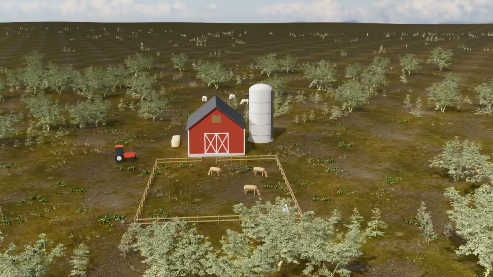
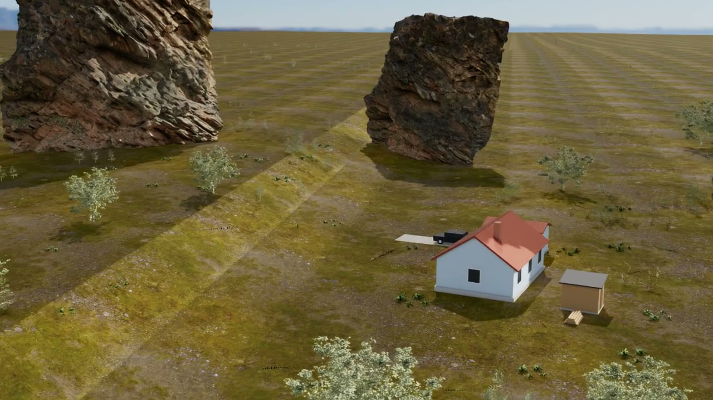
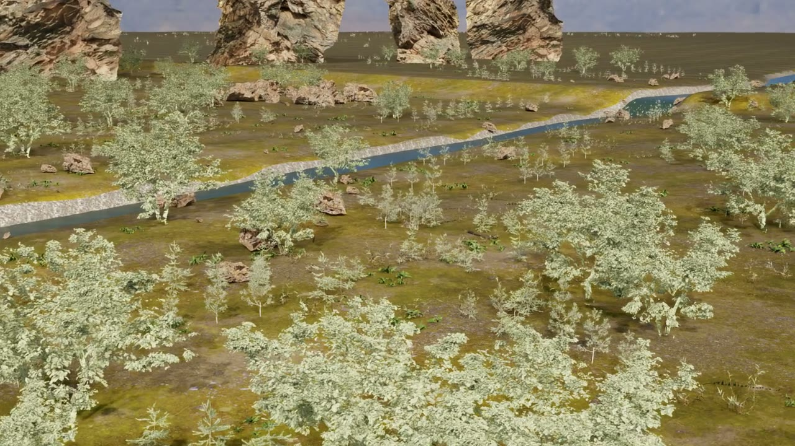
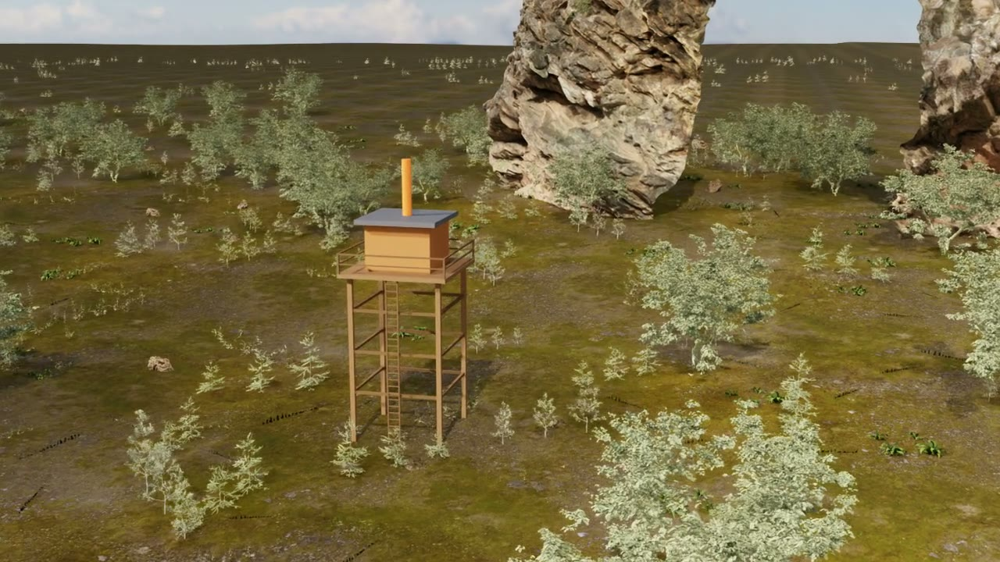
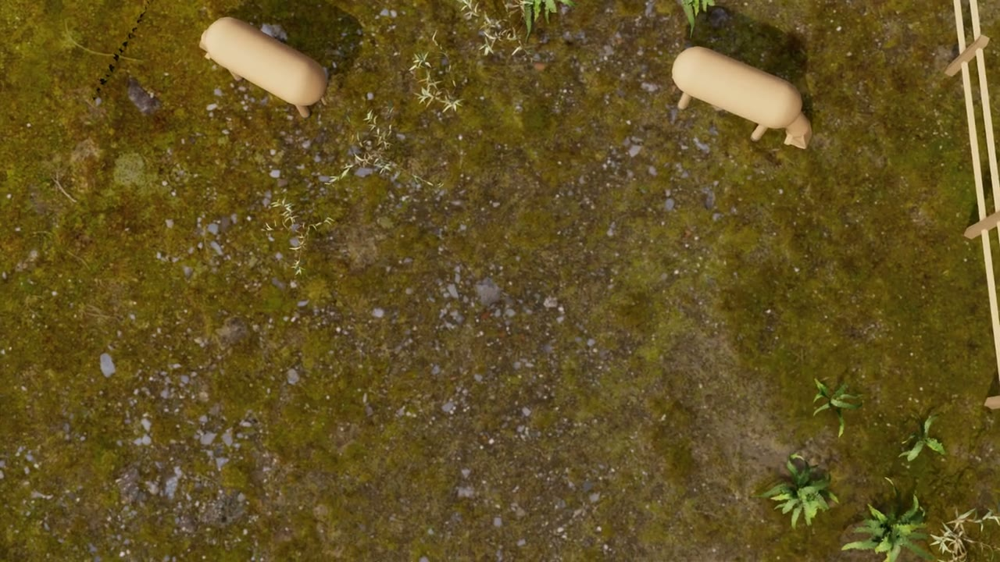
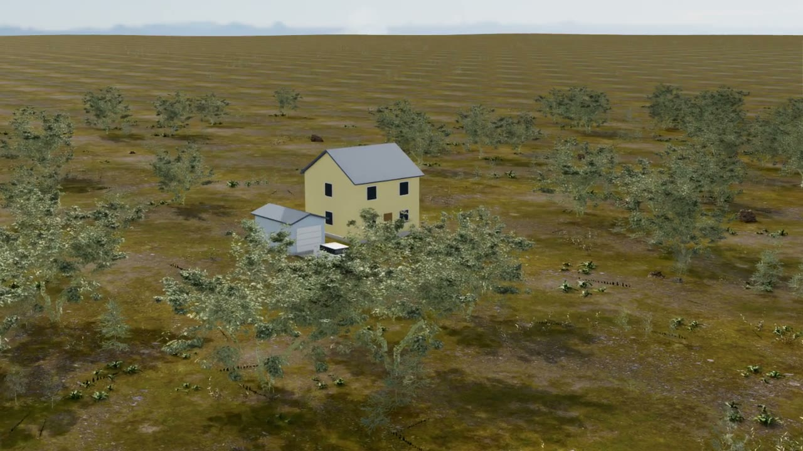
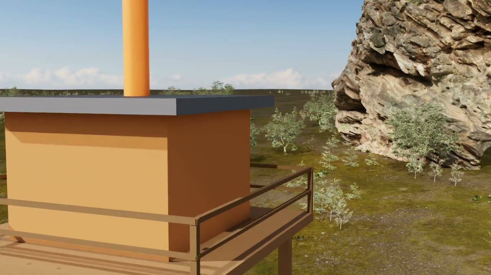

# VLN-X500 Bench

**A vision-and-language navigation benchmark for a real autopilot: a PX4 X500 quadrotor flying in a photorealistic
NVIDIA Isaac Sim forest, following one natural-language instruction, with PhysX-exact collision checking.**

<p align="center">
  
</p>

Each episode gives an agent an onboard RGB camera, its pose and one instruction such as

> *"The target is on your left. Fly to the pale blue house with the red tile roof (a garage and a parked car next to it)
> and stop about 2 m from it, facing it."*

The agent flies the drone with **stick commands** through the real **PX4 v1.14.3** flight stack, in Position mode, and
says **STOP** when it thinks it is done. A hidden goal file and the evaluator then decide whether the task was done. A
single contact of any part of the drone with anything in the scene fails the episode; the contact is detected by
**NVIDIA PhysX**, not by a distance threshold.

This repository contains **everything** needed to build the scenes, fly and record the expert demonstrations, publish
the episodes and score any flight. That includes PX4, Pegasus Simulator, the 3D assets and the render settings.

---

## Contents

1. [Gallery](#gallery)
2. [Task types](#task-types)
3. [How it works](#how-it-works)
4. [Episode format](#episode-format)
5. [Rules: success, collisions, failures](#rules-success-collisions-failures)
6. [Metrics](#metrics)
7. [Repository layout](#repository-layout)
8. [Requirements and installation](#requirements-and-installation)
9. [Configuration](#configuration)
10. [Usage](#usage)
11. [Running on another machine](#running-on-another-machine)
12. [Reproducibility](#reproducibility)
13. [Cluster operations](#cluster-operations)
14. [Known issues](#known-issues)
15. [Third-party components and licences](#third-party-components-and-licences)
16. [Git and large files](#git-and-large-files)

---

## Gallery

All images are frames of the published onboard camera videos (1280 × 720, 30 fps). They are not separate renders.

| | |
|:---:|:---:|
|  |  |
| **Inspect**: approaching a house between rock towers | The valley: river, cliffs, trees and scattered rocks |
|  |  |
| **Land**: the fire lookout tower, the landing reference | **Flyover**: the stop pose, camera looking straight down at the paddock |
|  |  |
| A homestead seen from the start altitude | Descending next to the lookout tower |

The scene is a procedurally laid-out valley: terrain, a river, cliffs and rocks, Poly Haven trees, and an "Easy v2"
props layout of houses, barns with silos, cars, tractors, fenced paddocks, herds of animals and lookout towers. Every
scene `easy_v2_<idx>` is generated from a fixed seed, so it is identical every time it is built.

---

## Task types

There are four task types. Scene `idx` gets type `(idx − 101) mod 4`, so the 100 benchmark scenes (101–200) have 25 of
each. The tolerance is **±5 m** for every type.

| Type | What the agent must do | Example instruction (short form) | Success at STOP |
|---|---|---|---|
| **inspect** | stop D m from the target, facing it (D = 1–10 m) | *"Stop about 2 m from the pale blue house on your left, facing it."* | 3D distance to the target box = D ± 5 m, and the target point is in the image with a 10 % margin |
| **orbit** | circle the target once, R m from its centre, in a given direction, facing it the whole way | *"Circle the herd on your left once clockwise (seen from above), facing them, about 21 m from their centre, then stop."* | ≥ 360° swept around the target's centre in the right direction, counting only frames at horizontal distance R ± 5 m |
| **flyover** | stop right above the target, camera looking down | *"Stop right above the centre of the paddock on your left, looking down at it."* | horizontal distance ≤ 5 m, ≥ 2 m above the target's top, the target point in the image with a 10 % margin |
| **land** | land D m from a structure (house, barn, lookout tower, cairn; D = 5–10 m) | *"Land about 9 m from the lookout tower on your left."* | PX4 reports the drone on the ground (or disarmed) and the 3D distance to the target box = D ± 5 m |

Every type also requires:
- STOP within the episode's time limit (90–110 s);
- no PX4 failure during the episode;
- no collision.

**Instruction rules:**
- the target is unique in the scene and is described by its appearance;
- every number says what it is measured from;
- directions are `left` / `right` / `ahead` / `behind` relative to the drone's heading at the start pose. Compass words
  are never used.

Each episode has one canonical instruction, three paraphrases (similarity to the canonical text < 0.8) and a short form.

---

## How it works

```mermaid
flowchart LR
    S0["0 · Setup<br/>conda env, PX4 build, assets"] --> S1
    S1["1 · Define the task<br/>scene + target + instruction<br/><i>benchmark_tasks.py</i>"] --> S2
    S2["2 · Fly the expert (GPU)<br/>Isaac Sim + PX4 + PhysX<br/><i>flight_runner.py</i>"] --> S3
    S3["3 · Render the video (GPU)<br/>onboard camera → mp4<br/><i>render_video_slice.py</i>"] --> S4
    S4["4 · Publish the episode<br/>task / goal / reference<br/><i>publish_episode.py</i>"] --> S5
    S5["5 · Verify<br/>score the expert + evaluator self-test"] --> S6
    S6["6 · Evaluate an agent<br/><i>evaluate.py</i>"]
```



Stages 1–5 run for all 100 scenes with one command (`jobs/make_batch.py`). Stage 6 scores any agent's flight with the
same evaluator that verified the expert. The full stage-by-stage description, with every file involved, is in
**[PIPELINE.md](PIPELINE.md)**.

### 1. Define the task: `simulation/benchmark_tasks.py`

For scene `easy_v2_<idx>` the code:
1. picks a target that is unique in the scene;
2. chooses the numbers (stand-off distance or radius);
3. picks the start pad;
4. writes the instruction, its paraphrases and the short form;
5. builds the expert's "beats": timed stick commands.

`route_clear` then flies the beats with an offline pilot model and rejects the plan if any point comes within 3 m of a
static obstacle (1 m during take-off and landing).

**Route planner (optional A\*).** By default the expert flies a straight line to the target, and a variant with an
obstacle in the way is rejected. With `BENCH_ROUTE_PLANNER=astar`, the transit legs (start → target, target → post-roll
pad) are planned by `simulation/astar_route.py` instead, so the expert flies around trees, rocks and buildings:

1. **Occupancy grid.** Built directly from the known obstacles (no point cloud needed). Each 2 m cell stores its lowest
   safe height: ground + 5 m, or the top + 4.5 m of any obstacle within its radius + 4.5 m.
2. **A\*.** Searches the 3D voxels (2 m cells × 2 m layers). Each extra metre of climb and each metre above the preferred
   height costs extra, so going around is preferred over going over.
3. **Simplification.** Keeps only the turning points (line of sight, checked at the lower of each leg's two end heights)
   and merges legs shorter than 8 m.
4. **Beats.** Each leg becomes a `goto` beat with an explicit height, flown by `pilot.py` through PX4 with the camera ahead.

`BENCH_ROUTE_AGL=<m>` sets the preferred height above the ground. Without it, each leg keeps the straight route's own
height (25 m, or 20 m for land). `route_clear`, the coverage gate, the camera-ahead rule and PhysX still check every A\*
route. When the variable is unset, the plans are byte-identical to the Forest Easy batch.

### 2. Fly the expert: `simulation/flight_runner.py` (one H100 GPU)

1. **Scene.** `environments/common/sim/scene_loader.py` builds the Forest valley and the props layout in Isaac Sim 5.1.
2. **Drone.** `environments/common/sim/x500_drone.py` spawns the X500 through Pegasus Simulator and starts PX4 SITL. The
   two talk MAVLink HIL. The airframe `10050_isaac_x500` is PX4's own `4001_gz_x500` with fixed stick settings.
3. **Colliders.** `collision/collision_shapes.py` gives everything a collider:
   - rotor discs;
   - proxy shapes for trees, rocks and logs;
   - exact mesh colliders for cliffs and rocks;
   - colliders for every other visible prim;
   - continuous collision detection (CCD).

   A **coverage gate** then refuses to fly if any visible prim still has no collider.
4. **Flight.** `environments/common/sim/pilot.py` sends the beats as MAVLink `MANUAL_CONTROL` sticks.
5. **Every physics step (240 Hz):** `collision/contact_monitor.py` reads PhysX contact reports. The first prohibited
   contact ends the flight.
6. **Every video frame (30 Hz):** one telemetry record is written: pose, velocity, camera pose and extrinsics, PX4
   status, and clearance to the nearest collider from PhysX scene queries.

A flight has three phases, and only the middle one is published:

```
 pre-roll (not published)          EPISODE (published + evaluated)               post-roll (not published)
 take off, climb, turn to   →      hover at the start pose → fly the task →  →   fly to the landing pad, land
 the start heading                 STOP
```

### 3. Render the video: `environments/common/sim/render_video_slice.py`

The recorded poses are replayed in the same scene, and the onboard camera is rendered in slices of 900 frames. The
slices are encoded to H.264 by `encode_video.py`.

### 4. Publish the episode: `publishing/publish_episode.py`

This step cuts out the episode frames and converts the collision record to episode time. Then it writes
`Simulation_N/`. It **refuses** to publish if:
- the flight is not OK;
- the collision monitor was not verified;
- the expert touched anything;
- PX4 reported a failure;
- an instruction uses a compass word or names the wrong side;
- a paraphrase drops the distance or is too close to the canonical text.

### 5. Verify: `evaluation/evaluate.py` + `evaluation/evaluator_selftest.py`

- The expert flight must score **success = true** and **collided = false**.
- The self-test edits copies of the expert flight (a collision, a wrong distance, no STOP, …) and checks that the
  evaluator fails each one.
- `simulation/flight_quality.py` checks that the camera looks where the drone flies.

An episode that fails any check is moved to `Benchmark_runs/_rejected/`, and the next attempt flies another variant
of the scene.

---

## Episode format

```
Benchmark/Easy/Forest/Simulation_N/
├── task.json                 what the agent receives
├── goal.json                 HIDDEN: target, success rule, collision criteria, metric definitions
├── reference/                the expert demonstration
│   ├── trajectory.mp4        onboard RGB, 1280×720, 30 fps
│   ├── action.json           stick commands + gimbal pitch, with how long each was held
│   ├── telemetry.json        one record per video frame
│   └── collisions.json       the contact monitor's record (verified, no prohibited contact)
└── results/
    ├── reference_score.json  the evaluator's score of the expert flight
    └── checker_selftest.json evaluator self-test, all PASS
```

### `task.json`: what the agent gets

| Field | Content |
|---|---|
| `instruction`, `instruction_paraphrases[3]`, `instruction_short` | the task in natural language |
| `start` | `xyz`, `yaw_deg`, `camera_pitch_deg`. The drone is hovering, armed, in PX4 Position mode; the runner flies the take-off itself |
| `time_limit_s` | 90–110 s, depending on the task |
| `observation.rgb` | 1280 × 720 @ 30 fps, pinhole camera, focal length 24 mm, HFOV 47.17°, VFOV 27.59°, fx = fy = 1466 px |
| `observation.pose` | drone position (ENU m) and heading every frame |
| `action` | see below |
| `coordinate_frame` | ENU metres (x east, y north, z up); yaw 0 = +x, counter-clockwise positive; camera pitch positive = down |

### Action space

The agent decides every **0.5 s**.

| Action | Range | Meaning |
|---|---|---|
| `x1` | −1 … 1, step 0.1 | yaw; + = rotate clockwise. Full stick = 60 °/s |
| `y1` | −1 … 1, step 0.1 | throttle; + = climb. Full stick = 3 m/s up, 2 m/s down |
| `x2` | −1 … 1, step 0.1 | roll; + = move right. Full stick = 8 m/s |
| `y2` | −1 … 1, step 0.1 | pitch; + = move forward. Full stick = 8 m/s |
| `gimbal_pitch_deg` | 0 … 80, step 5 | camera tilt; + = down; slew 35 °/s |
| `STOP` | — | ends the episode; the drone holds its position |

The sticks reach PX4 v1.14.3 as MAVLink `MANUAL_CONTROL` in Position mode. The drone is flown by PX4's own controllers,
not by a kinematic model.

### `telemetry.json`: one record per frame

`frame`, `t`, `action_index`, `physics_step`, `pose` (x, y, z, roll, pitch, yaw), `attitude_quat_xyzw`, `velocity`,
`agl_m`, `camera` (position, yaw, pitch), `camera_extrinsics` (`R_wc`, `t_wc`), `px4` (armed, mode, landed_state,
system_status) and `clearance` (nearest collider and its distance, also excluding the terrain).

---

## Rules: success, collisions, failures

These rules are fixed and are enforced by code.

**Collisions (collision-v2, `collision/contact_monitor.py`)**
- A touch is any PhysX contact with impulse > 0. There is no distance, force or speed threshold of ours.
- The first prohibited contact by a rotor, the airframe or the landing gear ends and fails the episode.
- In *land* tasks, only the landing gear may touch the terrain within the landing radius.
- Pairs that PhysX reports inside its 0.04 m contact offset with zero impulse are recorded as proximity, never as a
  collision.
- A flight without a verified collision record is **invalid**, never "collision-free".

**Flight failure**
- A flight fails only if PX4 reports it: HEARTBEAT `system_status` is CRITICAL, EMERGENCY or FLIGHT_TERMINATION.
- There are no tilt, height or speed limits of ours. How the agent flies is its own decision.

**Coverage**
- No flight starts until every visible object has a collider or is explicitly listed as non-solid. This is the
  coverage gate in `flight/coverage_gate.json`.

**Camera**
- While the expert moves, its camera looks along the direction of travel, 12° down, so the target has to be found
  with a forward view.
- `simulation/flight_quality.py` rejects any expert flight that breaks this rule.
- **Orbit** (since 2026-11-24): after finding the target with the forward view, the expert circles it **facing it**,
  nose and camera on the target, sliding sideways. The target stays in the image for about 98 % of the circle. While
  circling, a frame with the target in the image passes the camera rule.

---

## Metrics

Per episode, `evaluation/evaluate.py` computes:

| Metric | Definition |
|---|---|
| **SR** | success: the task rule above, with the collision rule included |
| **OSR** | oracle success: at some frame the drone satisfied the task's position condition with the target in view |
| **NE** | navigation error at STOP = abs(3D distance to the target box − D) |
| **SPL** | SR × reference_path / max(path, reference_path) |
| heading error | angle between the drone heading and the direction to the target at STOP |
| collided, time / part / impulse / force / speed of the first contact | from the PhysX contact record |
| min clearance | the smallest distance to any collider during the episode, also excluding the terrain |
| success without the collision rule | the same rule, with contacts ignored, on a record-only flight |

At benchmark level: **CR** = collided episodes / valid episodes, and the **collision gap** = SR without the collision
rule − SR. The maths is written out in [docs/metrics_math_hy.md](docs/metrics_math_hy.md), which is in Armenian.

---

## Repository layout

```
Benchmark_codebase/
├── README.md                     this file
├── PIPELINE.md                   every stage in detail, with every file involved
├── environment.yml               the Python environment (Isaac Sim 5.1 + pymavlink + scipy)
├── environments/                 Isaac Sim scene and drone: everything a flight loads
│   ├── common/
│   │   ├── sim/                  scene_loader.py (scene boot, camera), x500_drone.py (PX4 X500 on Pegasus),
│   │   │                         pilot.py (stick pilot), render_video_slice.py + encode_video.py (onboard video)
│   │   ├── vln_simulation/       natural_valley.py (terrain, river, vegetation), mission_contract.py
│   │   ├── assets/               polyhaven-v2/ (trees, rocks, ground, sky; CC0), x500/ (drone model)
│   │   ├── isaac_settings/       render experience (.kit), MDL materials, renderer settings
│   │   ├── px4_patches/          the PX4 airframe and the Pegasus patch (the only changes to both)
│   │   └── px4_env/              PX4-Autopilot v1.14.3 (source + built px4_sitl_default) + PegasusSimulator
│   └── Forest/
│       ├── easy_v2.py            seeded props layouts: houses, barns, cars, herds, towers
│       ├── missions.py           take-off and landing pads
│       └── scene/                forest_bridge.py, forest_scene.py (river), hq_bridge.py, props.py,
│                                 obstacle_sample/ (static obstacles for the offline tools)
├── simulation/
│   ├── benchmark_tasks.py        the four task types: targets, numbers, instructions, expert beats, route check
│   ├── astar_route.py            optional A* transit planner (BENCH_ROUTE_PLANNER=astar): occupancy grid, A*, legs
│   ├── expert_flight_plan.py     the expert plan of a run
│   ├── flight_runner.py          one flight: scene + X500 + PX4, contact monitor, telemetry, clearance
│   ├── flight_quality.py         the camera-ahead rule
│   ├── stick_pilot.py            "hold these sticks for N s" beats
│   ├── episode_frames.py         which frames form the episode
│   └── debug_video.py            optional external-camera debug video (never published)
├── collision/
│   ├── contact_monitor.py        collision-v2: touch iff PhysX impulse > 0
│   ├── collision_shapes.py       colliders for everything, coverage gate, static obstacle list, CCD
│   └── episode_collisions.py     flight record → episode collisions.json
├── publishing/
│   ├── publish_episode.py        writes Simulation_N (with every refusal check)
│   └── instructions.json         hand-written instructions of the older scenes 1–100
├── evaluation/
│   ├── evaluate.py               SR / OSR / NE / SPL + collision metrics for one flight
│   ├── camera_geometry.py        projection, heading error, swept angle, path length
│   └── evaluator_selftest.py     the evaluator must fail edited copies of the expert flight
├── jobs/
│   ├── config.sh                 ALL machine-specific paths and cluster settings
│   ├── make_batch.py             batch driver: GPU jobs → publish → score → self-test, restart-safe
│   ├── make_episode.sh           driver for one scene
│   ├── gpu_fly_and_render.sbatch the GPU job: flight + video slices
│   ├── audit_coverage.sbatch     GPU, no flight: coverage report + static obstacle list
│   ├── publish_early.sh          optional: publish the data files before the video is done
│   └── bad_gpus.txt              GPUs known to crash Isaac Sim (skipped)
├── tools/
│   ├── offline_preview.py        every plan without Isaac Sim: numbers, wording, camera rule
│   ├── check_flights.py          flown flights vs. every static obstacle (a safety net next to PhysX)
│   ├── gpu_incident.py           GPU failure records: summary per GPU / node
│   └── offline_pxr_stub/         stand-in for pxr so the offline tools can import the scene code
├── tests/
│   ├── test_contact_monitor.py   the collision rule, 10 cases
│   ├── test_task_types.py        the four success rules, 20 cases
│   ├── test_astar_route.py       the A* planner: self-test, every scene planned at a low height, clearance, camera rule
│   └── collision_test_scenarios.py  real collision test flights (wall, tree, ceiling, …)
├── docs/                         collision method, official references, metrics maths and task description
│                                 (the last two in Armenian), images/
└── logs/                         driver and Slurm logs (not in git)
```

---

## Requirements and installation

### Hardware

| | Needed |
|---|---|
| GPU | an NVIDIA RTX-capable GPU. Flights here run on one **H100** each |
| RAM | about **160 GB** per flight job |
| OS | Linux x86_64. The PX4 binary in `px4_env/` is built for it |
| Scheduler | Slurm, used by the batch drivers. A single flight can also be started by hand |

The offline tools (`tools/`, `tests/`, `evaluation/`) need only Python 3 with numpy/scipy. They run on any machine.

### Software

PX4, Pegasus, the assets and the render settings are **inside** this repository. Only the Python environment and
ffmpeg are installed separately.

```bash
conda env create -f environment.yml          # Python 3.11, Isaac Sim 5.1.0, pymavlink, scipy, numpy, Pillow
conda activate vln_x500_bench
conda install -c conda-forge ffmpeg          # if ffmpeg is not on PATH
```

The environment used for every published episode:

| Package | Version |
|---|---|
| Python | 3.11.16 |
| isaacsim | 5.1.0.0 (Kit 107.3.1) |
| pymavlink | 2.4.49 |
| numpy | 1.26.0 |
| scipy | 1.15.3 |
| Pillow | 11.3.0 |

### PX4 and Pegasus

`environments/common/px4_env/` holds PX4-Autopilot **v1.14.3**, with `px4_sitl_default` already built, and Pegasus
Simulator (commit `e13dc65`). To rebuild them from upstream, check out those versions and apply the two changes in
[`environments/common/px4_patches/`](environments/common/px4_patches/README.md): the airframe `10050_isaac_x500` and
`pegasus_simulator.patch`. Then run `make px4_sitl_default` in `PX4-Autopilot`.

---

## Configuration

Every machine-specific setting is in **`jobs/config.sh`**. Each one can also be overridden by exporting the variable.

| Variable | Default | Meaning |
|---|---|---|
| `BENCH_CODE` | this folder | the code |
| `BENCH_DATA` | `/mnt/weka/sgrigoryan/Benchmark` | published episodes: `Easy/Forest/Simulation_N` |
| `BENCH_RUNS` | `/mnt/weka/sgrigoryan/Benchmark_runs` | raw flights, video slices, rejected attempts, GPU incidents |
| `CONDA_ROOT`, `CONDA_ENV` | `/mnt/weka/shared-cache/miniforge3`, `behavior_h100` | the Python environment |
| `SLURM_PARTITION` | `research` | the GPU partition |
| `EXCLUDE_NODES` | `gpu01,gpu02,gpu06` | nodes that are never used |
| `GPU_INCIDENTS` | `$BENCH_RUNS/_gpu_incidents` | one folder per GPU / Isaac Sim failure |

---

## Usage

All commands are run from the repository root.

**1. Preview every plan offline.** No GPU is needed.
```bash
python3 tools/offline_preview.py 101 200
```

**2. Build all 100 episodes.** This is restart-safe; the state is kept in `logs/make_batch_state.json`.
```bash
nohup python3 jobs/make_batch.py --first 101 --last 200 --max-jobs 35 >> logs/make_batch.log 2>&1 &
```
Scene `easy_v2_<idx>` becomes `Simulation_<idx − 100>`.

**3. Build one episode.**
```bash
nohup bash jobs/make_episode.sh 87 "" Simulation_N >> logs/make_episode_087.log 2>&1 &
```

**4. Score a flight**, either the expert's or an agent's.
```bash
python3 evaluation/evaluate.py $BENCH_DATA/Easy/Forest/Simulation_1 \
    --telemetry <telemetry.json> --actions <action.json> [-o result.json]
```
The `collisions.json` next to the telemetry is found automatically.

**5. Run the tests.**
```bash
python3 tests/test_contact_monitor.py                                    # 10 PASS
python3 tests/test_task_types.py                                         # 20 PASS
python3 tests/test_astar_route.py 101 200 10                             # A* at 10 m: PASS
python3 evaluation/evaluator_selftest.py $BENCH_DATA/Easy/Forest/Simulation_1
```

---

## Running on another machine

1. Clone the repository with Git LFS (see [below](#git-and-large-files)).
2. Create the Python environment from `environment.yml`.
3. Edit `jobs/config.sh`: set `BENCH_DATA`, `BENCH_RUNS`, `CONDA_ROOT`, `CONDA_ENV`, `SLURM_PARTITION` and
   `EXCLUDE_NODES`.
4. Run `python3 tools/offline_preview.py 101 105` and the tests to check the code and the paths.
5. Fly one scene with `jobs/make_episode.sh` before starting a batch.

A few files keep a cluster path as a fallback, used only when the active environment does not provide the tool:
- `encode_video.py`, `render_video_slice.py` and `publish_episode.py` fall back to the cluster's ffmpeg when `ffmpeg` is
  not on `PATH`;
- `hq_bridge.py` falls back to a cluster Isaac Sim path when `isaacsim` is not importable;
- in Pegasus, `configs.yaml` has a `px4_dir` default, which `x500_drone.py` overrides.

With the environment active, none of these fallbacks is used.

The Forest scene uses only the local assets. Nothing is downloaded at run time.

---

## Reproducibility

| | Same every time? |
|---|---|
| Scene geometry, props and animals (`easy_v2_<idx>`) | **yes**: built from a fixed seed |
| Target, numbers, start pose, instructions | **yes**: built from the scene and the task index |
| Expert stick sequence | **yes** |
| Flown trajectory | **almost**: PhysX, PX4 timing and the GPU give centimetre-level differences between runs |

The published `reference/telemetry.json` is the ground truth for an episode. The evaluator always scores against
`goal.json`, never against a re-flight.

---

## Cluster operations

- **Bad GPUs.** A GPU that crashes Isaac Sim makes the job exit with code 76. The drivers then resubmit the job
  elsewhere. GPUs that keep failing are listed in `jobs/bad_gpus.txt`; nodes that keep failing go into
  `EXCLUDE_NODES`.
- **GPU incidents.** Every failed run is recorded in `$GPU_INCIDENTS/<time>_<node>_<gpu>_job<id>_…/`, with the log
  excerpt, Isaac Sim's own log, the NVIDIA GPU crash dump and `nvidia-smi -q` from before and after the failure.
  `python3 tools/gpu_incident.py summary` counts failures per GPU and per node.
- **PX4 instances.** PX4 v1.14 gives unique MAVLink ports only to vehicle ids 0–9, so at most 10 flights can share a node.
- The login node has only 4 GB of RAM and 2 CPUs. Never run Isaac Sim on it.

---

## Known issues

Found by the audit of the first 13 published episodes (2026-11-22). They are documented here and are not fixed yet.
The flights themselves are sound: physics, collisions, video and telemetry. The issues are in how targets are defined
and in how the evaluator treats agent flights.

| Area | Issue |
|---|---|
| Target box | Houses are rotated, but their box is stored axis-aligned (`yaw_deg: 0`). The box is too large, so the scored distance is smaller than the real one, by up to about 3.4 m |
| Paddock target | The instruction says "the fenced paddock", but the scored box covers only the animals inside it |
| Wording | A few short instructions ("the paddock on your left") can fit two objects in the scene |
| Flyover | The in-view check only passes when the drone is at or slightly short of the target's centre, not past it |
| Landing | Landing on a driveway counts as a collision. The driveway is a separate collider, but only `/World/Terrain` is an allowed landing surface |
| Evaluator | The episode is scored at the last frame, not at STOP; the orbit's swept angle can be collected in short arcs; *landed* = disarmed, with no height check; a missing PX4 status passes |
| PX4 start-up | Rarely, PX4's estimator (EKF2) initialises with a wrong attitude, and the attempt is rejected (never armed, or a heading mismatch). The batch driver then flies the next attempt |

---

## Third-party components and licences

| Component | Where | Licence |
|---|---|---|
| PX4-Autopilot v1.14.3 | `environments/common/px4_env/PX4-Autopilot` | BSD-3-Clause |
| Pegasus Simulator | `environments/common/px4_env/PegasusSimulator` | BSD-3-Clause |
| Poly Haven assets | `environments/common/assets/polyhaven-v2` | CC0 |
| Render settings and materials (from OmniGibson) | `environments/common/isaac_settings` | MIT, see `LICENSE_OmniGibson` |
| NVIDIA Isaac Sim 5.1 | installed via pip, not included | NVIDIA Isaac Sim licence |

---

## Git and large files

- **`.gitignore`** excludes logs, Python caches, PX4 run-time files and Isaac Sim caches.
- **`.gitattributes`** sends large binaries through **Git LFS**: `*.usd`, `*.usdc`, `*.exr`, `*.hdr`, `*.blend`,
  `*.dae` and the PX4 binary. GitHub rejects files over 100 MB, and `jacaranda_tree_1k.usdc` is 266 MB.

Install Git LFS once, before the first `git add`:

```bash
conda install -c conda-forge git-lfs      # or: sudo apt install git-lfs
git lfs install
git init
git add .
git commit -m "VLN-X500 Bench codebase"
```

The full checkout is about 1.8 GB: PX4 is 0.8 GB, the assets 0.5 GB, and Pegasus plus the code the rest.
