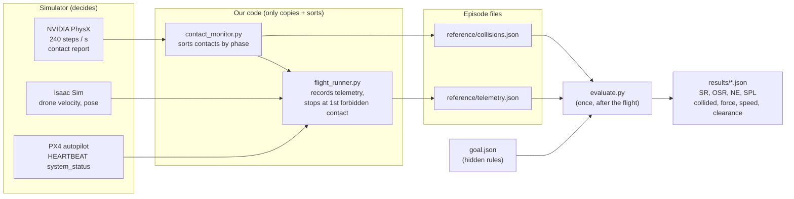
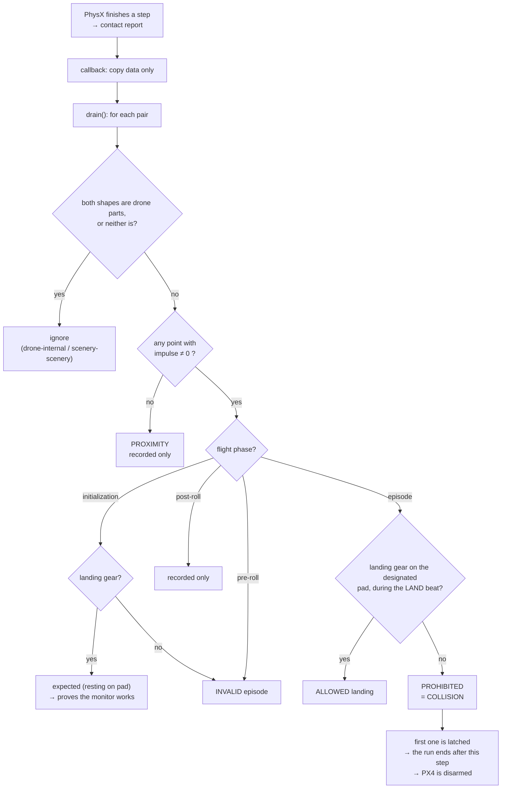
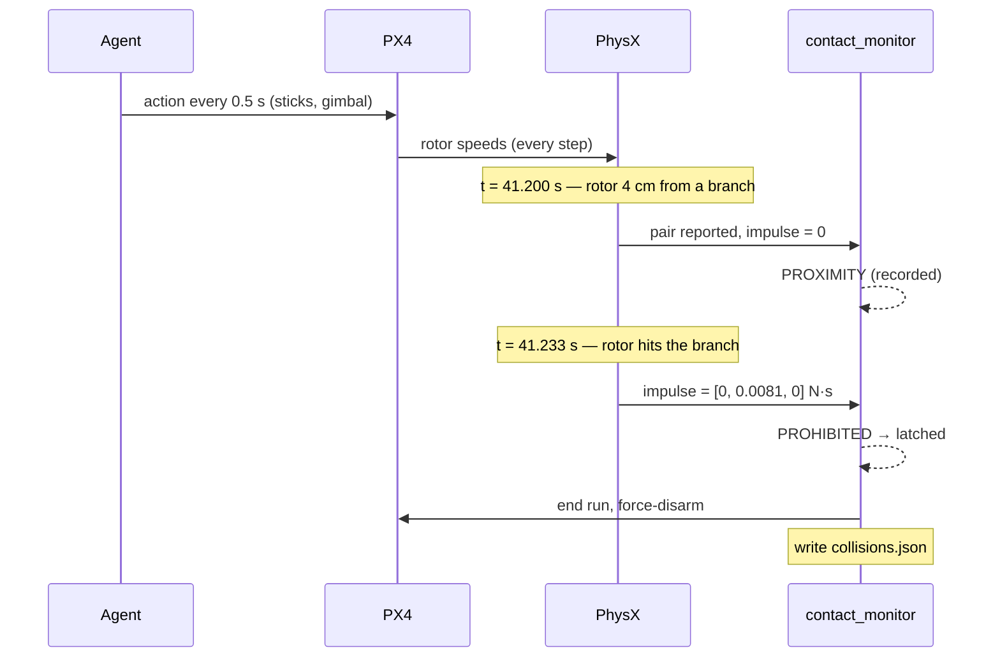
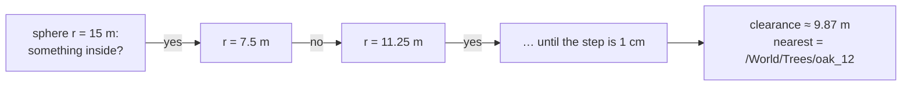
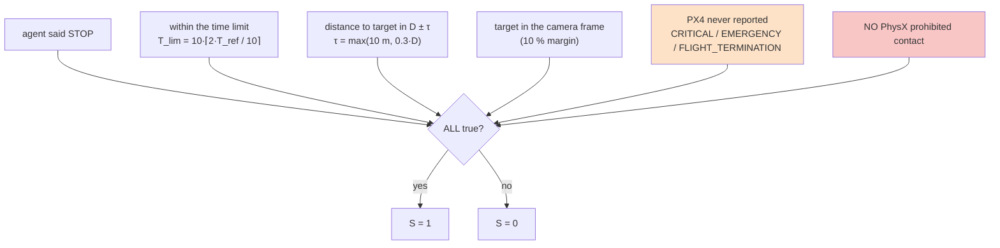
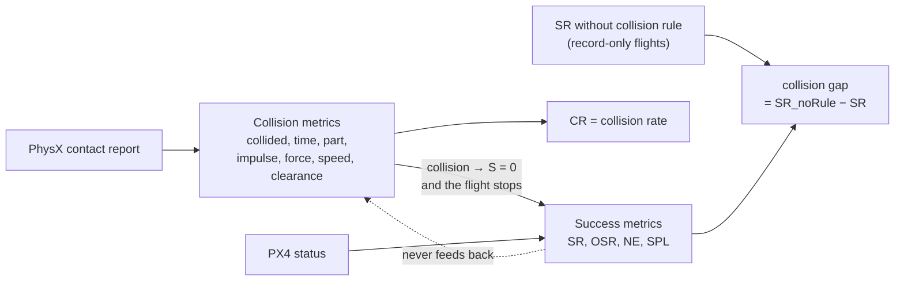

# How collision detection and the metrics work (v0.3b)

*A personal explainer, 2026-11-15 (written for the earlier collision codebase; the code now lives in this folder: `collision/`).*

---

## 1. The big picture in one sentence

PhysX (inside Isaac Sim) does the physics and **reports every contact**. Our code only:
1. **copies** that report;
2. **sorts** each contact by flight phase;
3. **stops** the run at the first forbidden one;
4. **writes** everything to `collisions.json`.

`evaluate.py` later turns those files into numbers.

---

## 2. What PhysX gives us at every physics step

Each drone part (body, 4 rotors, landing gear) has the **`PhysxContactReportAPI`** with threshold 0. That means PhysX reports **every** contact pair, even weak ones.

For each pair, PhysX sends a list of **contact points** (`PxContactPairPoint`):

| Field | Meaning | Example |
|---|---|---|
| `position` | where the contact is, in the world (m) | `[12.31, -4.02, 3.15]` |
| `normal` | the direction PhysX pushes the bodies apart | `[0.0, -1.0, 0.0]` |
| `separation` | gap between the shapes (m); ≤ 0 means overlapping | `-0.0012` |
| `impulse` | the push PhysX actually applied at this point (N·s, vector) | `[0, 0.0081, 0]` |

PhysX begins reporting a pair at **4 cm** (the *contact offset*), so it sees things **before** they touch. Swept **CCD** is on, so a fast drone cannot pass through a thin branch between two steps.

---

## 3. The one rule: impulse

> **A contact is a real touch only if PhysX applied an impulse at one of its points (impulse ≠ 0).**

- Impulse ≠ 0 → PhysX had to push the bodies apart → they **touched** → **touch**.
- Impulse = 0 → the bodies are only *near* each other, inside the 4 cm → **proximity**. It is recorded but never fails anything.

We add **no distance threshold** of our own. In v1 we had a "separation ≤ 5 mm" rule. It was removed because 3 of the 9 old test collisions came from that rule alone, with zero impulse.

---

## 4. What happens inside one physics step (1/240 s)

**Phases of a flight:**

| Phase | When | A touch here means |
|---|---|---|
| initialization | spawn → lift-off | gear on the pad is expected; anything else makes the episode **invalid** |
| pre-roll | lift-off → episode start | **invalid** (the setup is broken, not the agent's fault) |
| **episode** | the part that is scored | **collision** (except the landing exception) |
| post-roll | after the episode | recorded only |

**Monitor self-check:** if PhysX never reported the gear resting on the pad during initialization, `monitor_verified = false` and the episode is **INVALID**, not "collision-free". We never score a flight as safe when we could not show that contact detection was working.

---

## 5. A collision on a timeline (example)

---

## 6. How each collision metric is calculated

All of these come from simulator numbers. Our code only does the arithmetic.

| Metric | Formula | Comes from |
|---|---|---|
| **collided** | `first_prohibited` exists (inside the time limit, before STOP) | PhysX contact report |
| **time_to_first_collision_s** | `t` of that contact | PhysX step × 1/240 s |
| **collision_part** | which drone part touched: `rotor` / `airframe` / `landing_gear` | the PhysX collider path |
| **collision_impulse_ns** | **J** = Σ over contact points of \|impulse vector\| | `PxContactPairPoint.impulse` |
| **peak_contact_force_n** | **F = J / Δt = J × 240** | PhysX docs: "divide the impulse by the time step to get a force" |
| **impact_speed_mps** | \|v\| = √(vx² + vy² + vz²) at the contact step | Isaac Sim rigid-body velocity |
| **min_clearance_m** | smallest distance to any collider over the flight | PhysX scene query (sphere overlap) |
| **min_clearance_non_terrain_m** | same, ignoring the ground | same |
| **CR** (benchmark level) | collided episodes / all episodes | aggregation (script not written yet) |

**Worked example** (the numbers from the self-test):
- impulse at 1 point = `[0, 0.01, 0]` N·s → **J = 0.01 N·s**
- force: **F = 0.01 × 240 = 2.4 N**
- velocity at contact = `[3, 4, 0]` m/s → **impact speed = √(9 + 16) = 5.0 m/s**

**How clearance is measured:** at each video frame we ask PhysX: *"is there any collider inside a sphere of radius r around the drone?"* (`overlap_sphere`).
- r is halved again and again (bisection) between 0 and 30 m until the step is 1 cm.
- The drone's own colliders are skipped.
- The result is the distance to the nearest object, plus its name.
- Clearance is **only a measurement**: it never fails an episode.

---

## 7. How success is calculated, and where the collision enters

**Success S = 1** only if **all** of these are true:

The two coloured boxes are the simulator's verdicts: **PhysX** gives the collision and **PX4** gives the flight failure. The other four define the task.

**Navigation metrics:**

| Metric | Formula | Effect of a collision |
|---|---|---|
| **SR** | mean of S | S = 0 |
| **OSR** | the goal state (distance band + in frame) reached at **any** frame, with no PX4 failure | counted only **up to the contact** |
| **NE** | \|d_T − D\|, d_T = horizontal distance to the target at the end | measured **at the contact** |
| **SPL** | S · L_ref / max(L, L_ref) | 0, because S = 0 |

Timing: if the agent said **STOP before** the contact, the episode had already ended, so the contact does not count. A contact **after the time limit** is also outside the episode.

---

## 8. How the metrics depend on each other (one direction only)

- **Collision → Success: yes.** A collision makes S = 0 and cuts the flight short, so OSR, NE and SPL are measured only up to that point.
- **Success → Collision: no.** The collision metrics are computed the same way for every flight, successful or not.
- **The collision gap** shows how many successes were lost **only** because of collisions. It needs *record-only* flights, where the contact is recorded and the flight continues. The evaluator supports this mode; a Forest flight runner for it is not written yet.

---

## 9. What the simulator decides vs what we decide

| Decided by the **simulator** | Chosen by **us** (setup / rules, not corrections) |
|---|---|
| whether a contact happened (impulse) | stop at the first collision (benchmark rule) |
| where, which part, how strong | the landing exception (gear on the pad during landing) |
| how the drone moves, bounces, falls | PhysX settings: 4 cm contact offset, rest offset 0, CCD, collision shapes |
| whether the flight failed (PX4 status) | task definition: D, τ, 10 % frame margin, time limit |
| velocity and clearance | — |

No collision is ever decided or corrected by hand.

---

## 10. Files

| File | Contents |
|---|---|
| `reference/collisions.json` | the PhysX contact record: `monitor_verified`, `first_prohibited` (step, t, part, collider, points with impulse and separation, `total_impulse_ns`, `drone_velocity_mps`), proximity and pair summaries |
| `reference/telemetry.json` | per frame: pose, camera, `px4.system_status`, `clearance` |
| `goal.json` | hidden: the success rules, `collision_criteria`, metric definitions |
| `results/reference_score.json` | output of `evaluate.py` |

Official sources for every item: `docs/official_references.md`.
